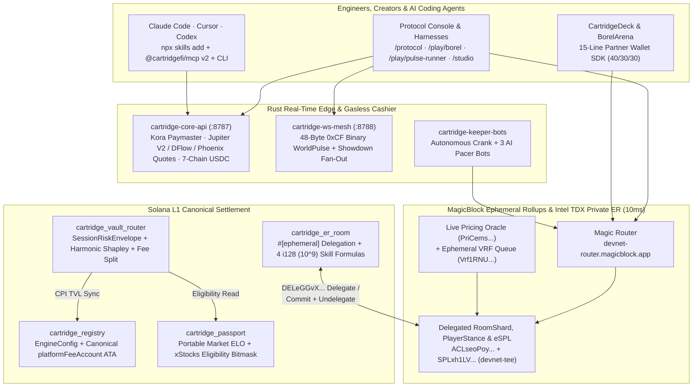

# CartridgeFi Protocol — Entertainment Finance Infrastructure (`Infra + DeFi + Privacy`) on Solana & MagicBlock

**CartridgeFi** (`v0.1.0-blitz-protocol`) is a parameterized **Entertainment Finance Protocol** on **Solana** and **MagicBlock Ephemeral Rollups (ERs) & Private Ephemeral Rollups (PER / Intel TDX TEE)**—providing `10ms` delegated state shards, zero-popup session keys, TEE anti-copy-trading permissions, verifiable randomness (`VRF`), private eSPL fee routing, and non-custodial multi-venue settlement.

Verified 100% live on Solana Devnet (`https://api.devnet.solana.com`), MagicBlock Router (`https://devnet-router.magicblock.app`), and Intel TDX Private ER (`https://devnet-tee.magicblock.app`):
- **Protocol Inspector & Live Execution Console (`/protocol`)** — Technical verification dashboard displaying live Devnet Program IDs, ER/TEE RPC latency probes, canonical `platformFeeAccount` SPL fee counter, and clickable Solscan transaction proofs.
- **Reference Harness `#001`: Borel (`/play/borel`)** — End-to-end protocol integration demo exercising delegated ER `RoomShard`s, 75% Intel TDX Fog-of-War -> Showdown unseal, VRF settlement, and claim-time payout routing (`NVDAx`, `ANTx`, `SPYx`, `USDC`).
- **Reference Harness `#002`: Pulse Runner (`/play/pulse-runner`) + Vibe Studio (`/studio`) + Agentic Stack (`SKILL.md` + `@cartridgefi/mcp` + CLI)** — Demonstrates multi-genre execution against the exact same 4 parameterized Anchor programs without custom smart contracts.

> **Live On-Chain Proof (`CARTRIDGEFI_STANDALONE_DEV=false`):** See [`docs/DEVNET_PROOF.md`](./docs/DEVNET_PROOF.md) and [`apps/web/src/data/devnet-proof.json`](./apps/web/src/data/devnet-proof.json) for all 33 confirmed Devnet + ER + TEE transactions.

---

## System Architecture



---

## Deployed Solana Devnet Programs, Relayer & `platformFeeAccount`

| Component | Pubkey / Endpoint | Role |
| :--- | :--- | :--- |
| **`cartridge_er_room` (P1)** | `Hqi5b6iY9rgnpRW8o5y1vamDU3Y9i6mKq49BDjZVxkFR` | `435,080 B` · Delegated `RoomShard` & `PlayerStance`, PER permissions, VRF request/callback, `MagicIntentBundleBuilder`, & 4 `i128` (`10^9`) formulas |
| **`cartridge_vault_router` (P2)** | `6hzFDMeBERxfzrgnWyzeptHknnMzwTr5u1FmVfG9eRBT` | `373,232 B` · Non-custodial `SessionRiskEnvelope`, Harmonic Shapley payouts, `50/50` & `40/30/30` fee splits into `platformFeeAccount` |
| **`cartridge_registry` (P3)** | `5tH1uFw8Lyf8NZ8YvMogwGWjLyRXrKBSJveKVbHm1nvr` | `188,752 B` · `EngineConfig` (`platform_fee_account`, TVL caps) & parameterized `CartridgeManifestAccount` PDAs |
| **`cartridge_passport` (P4)** | `5jkGrbF915SoaVbmxbjseUEswVydyXVXXBripyBN8cNr` | `182,040 B` · Portable Cross-Game Market ELO (`i128` `10^9`) & Geo/xStocks Eligibility Bitmask |
| **Relayer / App Wallet** | `D7ba9qSDTubn9S86nsTb1EgDSFE2rjCacGcmMDzfpWs1` | Executes TEE authentication, `delegateSpl`, private fee-paying eSPL transfers, and `withdrawSpl` |
| **`platformFeeAccount` (Canonical ATA)** | `6YR5GiT8KmnbPdhx5siRHBPWTtnxE3FQCGjkwyzbMzir` | Canonical SPL ATA of treasury owner `Giyjg9VusfUXJbNYT2W3gRHpfFPez1kPAE5YcWsmNjPd` for Devnet SPL mint `F6chXtYN1UUtxY1eNcbjnRDqnMWVYNUtqUqiy52pzWm1` |
| **MagicBlock Delegation / PER / eSPL** | `DELeGGvX...` · `ACLseoPo...` · `SPLxh1LV...` | Account delegation, ER-local permissions, and encrypted Magic ATA private SPL transfers |
| **MagicBlock Router & Private TEE** | `https://devnet-router.magicblock.app` · `https://devnet-tee.magicblock.app` | Dynamic ER routing (`10ms`) & Intel TDX hardware-encrypted execution |

---

## Agent Skill (`SKILL.md`), MCP v2 Server & CLI

### 1. Install the CartridgeFi Agent Skill (`Claude Code`, `Cursor`, `Codex`)

```bash
# Install from repository or published skill package
npx skills add ./packages/cartridgefi-skill
```

Includes `SKILL.md`, 5 deep-dive protocol references (`manifest-schema.md`, `scoring-formulas.md`, `session-keys-and-per.md`, `venue-routing.md`, `wallet-deck-embed.md`), and 3 compliant `CartridgeManifest v2.0` starter templates.

### 2. Connect `@cartridgefi/mcp` v2 (`stdio` or Streamable HTTP `/mcp`)

Add to `.mcp.json` or Claude Desktop / Cursor MCP settings:

```json
{
  "mcpServers": {
    "cartridgefi": {
      "command": "node",
      "args": ["packages/mcp-server/dist/cli.js", "--stdio"]
    }
  }
}
```

Exposes 6 deterministic tools: `discover_live_markets`, `compile_prompt_to_manifest`, `simulate_cartridge_economy`, `deploy_cartridge_devnet`, `inspect_room_telemetry`, and `generate_engine_client_bindings` (TypeScript, C# Unity, GDScript Godot).

### 3. `cartridgefi` Creator CLI & `<CartridgeDeck />` Wallet Embed

```bash
node packages/cli/dist/cli.js init my-nvda-blitz --genre BOREL_GAMEDAY
node packages/cli/dist/cli.js simulate ./my-nvda-blitz/cartridge.manifest.json --ticks 500 --regime crash_vix35
node packages/cli/dist/cli.js publish ./my-nvda-blitz/cartridge.manifest.json --network devnet
```

```tsx
import { CartridgeDeck } from "@cartridgefi/react";

export function PartnerWalletMiniApp({ userWallet }: { userWallet: string }) {
  return (
    <CartridgeDeck
      cartridgeSlug="borel-blind-conviction-blitz-001"
      partnerWallet={userWallet}
      partnerFeeVault="6YR5GiT8KmnbPdhx5siRHBPWTtnxE3FQCGjkwyzbMzir"
      mode="PAPER"
    />
  );
}
```

---

## Quickstart, Vercel Deployment & Full Verification Suite

```bash
# 1. Install dependencies & verify SHA-256 locked agent skills
pnpm install
pnpm skills:check

# 2. Build, typecheck & unit-test all TypeScript packages + Next.js 15 web app
pnpm build
pnpm typecheck
pnpm test

# 3. Compile optimized Anchor SBF binaries (opt-level = "z") & run LiteSVM + MagicSVM + 100k solvency fuzz tests
pnpm anchor:build
pnpm clippy:programs
pnpm test:litesvm

# 4. Verify Rust real-time edge services (#![deny(clippy::float_arithmetic)])
pnpm clippy:services
pnpm test:services

# 5. Priority-ordered Devnet deploy & full MagicBlock Blitz v10 on-chain proof
./scripts/deploy-devnet.sh
pnpm prove:blitz

# 6. Run Playwright Desktop (1440x900) & Mobile (390x844) headless E2E suite (incl. /protocol)
pnpm test:e2e
```

### Vercel Deployment (`apps/web`)
Root [`vercel.json`](./vercel.json) and [`apps/web/.env.example`](./apps/web/.env.example) are pre-configured for zero-config Vercel builds (`NEXT_PUBLIC_SOLANA_RPC_URL`, `NEXT_PUBLIC_MAGICBLOCK_ROUTER_URL`, `NEXT_PUBLIC_MAGICBLOCK_TEE_URL`). When external `core-api` or `ws-mesh` daemons are not attached, the web console gracefully degrades to direct Solana Devnet RPC + live MagicBlock ER oracle reads + deterministic 48-byte binary telemetry with zero uncaught WebSocket or console errors.