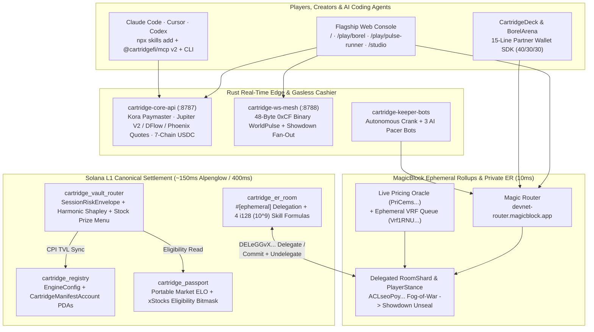

# CartridgeFi — The Entertainment Finance Game Engine on Solana & MagicBlock

**CartridgeFi** is the universal Entertainment Finance Game Engine on **Solana** and **MagicBlock Ephemeral Rollups (ERs) & Private Ephemeral Rollups (PER / Intel TDX TEE)**—turning perpetuals, prediction markets, and tokenized equities into `10ms`, zero-popup multiplayer skill games.

Proven live on Solana Devnet + MagicBlock Router (`https://devnet-router.magicblock.app`) by:
- **Borel (`#001`)** — Our First-Party Studio Flagship Game executing Solana RFS #11 (*Game-Day Mode for Prediction Markets*), RFS #3 (*Earned Stock Vault*), and RFS #7 (*Perps & Onchain Trading*). Features multiplayer Blind Conviction Blitz arenas where rival allocations stay hardware-encrypted inside a MagicBlock Private ER ("Fog of War") for the first 75% of the clock before unsealing live on screen in the final Showdown, paying winners in `NVDAx`, `ANTx`, `SPYx`, or `USDC`.
- **Pulse Runner (`#002`)** — A 60fps 3-lane arcade volatility runner proving that radically different game genres execute against the **exact same parameterized Anchor programs** without writing custom smart contracts.
- **Web Vibe-Coding Studio (`/studio`) + `<CartridgeDeck/>` Wallet SDK + Agentic Stack (`SKILL.md` + `@cartridgefi/mcp` + CLI)** — Compile natural-language game prompts into `CartridgeManifest v2.0` PDAs, run 500-tick fixed-point solvency simulations, embed 15-line mini-apps inside partner wallets (`40% / 30% / 30%` fee split), or build via Claude Code, Cursor, and Codex (`50% / 50%` creator fee split).

> **Live On-Chain Proof:** See [`docs/DEVNET_PROOF.md`](./docs/DEVNET_PROOF.md) for verified Solana Devnet Program IDs, binary rent audit, explicit `platformFeeAccount`, and live Solscan Devnet + MagicBlock ER transaction links (`CARTRIDGEFI_STANDALONE_DEV=false`).

---

## System Architecture



---

## Deployed Solana Devnet Programs & MagicBlock Constants

| Component | Pubkey / Endpoint | Role |
| :--- | :--- | :--- |
| **`cartridge-registry`** | `5tH1uFw8Lyf8NZ8YvMogwGWjLyRXrKBSJveKVbHm1nvr` | `EngineConfig` (`platform_fee_account`, guarded beta `$500` room / `$5,000` global TVL caps) & parameterized `CartridgeManifestAccount` PDAs |
| **`cartridge-er-room`** | `Hqi5b6iY9rgnpRW8o5y1vamDU3Y9i6mKq49BDjZVxkFR` | 200-player `RoomShard`, MagicBlock Delegation, PER Fog-of-War permissions, `ScheduleCrankCpi`, scoped `#[vrf]`/`#[vrf_callback]`, `MagicIntentBundleBuilder`, & 4 `i128` (`10^9`) skill formulas |
| **`cartridge-vault-router`** | `6hzFDMeBERxfzrgnWyzeptHknnMzwTr5u1FmVfG9eRBT` | Non-custodial `SessionRiskEnvelope` (`<= 5x` leverage, session-key custody isolation), Harmonic Shapley payouts, `50/50` & `40/30/30` fee splits, & Claim-Time Stock Prize Menu (`NVDAx`, `ANTx`, `SPYx`, `USDC`) |
| **`cartridge-passport`** | `5jkGrbF915SoaVbmxbjseUEswVydyXVXXBripyBN8cNr` | Portable Cross-Game Market ELO (`i128` `10^9`) & Geo/xStocks Eligibility Bitmask |
| **MagicBlock Delegation** | `DELeGGvXpWV2fqJUhqcF5ZSYMS4JTLjteaAMARRSaeSh` | Base-layer account delegation & ER commit/undelegation |
| **MagicBlock Permission (PER)** | `ACLseoPoyC3cBqoUtkbjZ4aDrkurZW86v19pXz2XQnp1` | ER-local `EphemeralPermission` (`is_private = true` Fog-of-War -> `false` Showdown) |
| **MagicBlock Devnet Router** | `https://devnet-router.magicblock.app` | Dynamic ER validator routing, blockhash resolution & 0-SOL session-key execution |

---

## Agent Skill (`SKILL.md`), MCP v2 Server & CLI

### 1. Install the CartridgeFi Agent Skill (`Claude Code`, `Cursor`, `Codex`)

```bash
# Install from repository or published skill package
npx skills add ./packages/cartridgefi-skill
```

Includes `SKILL.md`, 5 deep-dive protocol references (`manifest-schema.md`, `scoring-formulas.md`, `session-keys-and-per.md`, `venue-routing.md`, `wallet-deck-embed.md`), and 3 compliant `CartridgeManifest v2.0` starter templates.

### 2. Connect `@cartridgefi/mcp` v2 (`stdio` or Streamable HTTP `/mcp`)

Add to `.mcp.json` or Claude Desktop / Cursor MCP settings:

```json
{
  "mcpServers": {
    "cartridgefi": {
      "command": "node",
      "args": ["packages/mcp-server/dist/cli.js", "--stdio"]
    }
  }
}
```

Exposes 6 deterministic tools: `discover_live_markets`, `compile_prompt_to_manifest`, `simulate_cartridge_economy`, `deploy_cartridge_devnet`, `inspect_room_telemetry`, and `generate_engine_client_bindings` (TypeScript, C# Unity, GDScript Godot).

### 3. `cartridgefi` Creator CLI & `<CartridgeDeck />` Wallet Embed

```bash
node packages/cli/dist/cli.js init my-nvda-blitz --genre BOREL_GAMEDAY
node packages/cli/dist/cli.js simulate ./my-nvda-blitz/cartridge.manifest.json --ticks 500 --regime crash_vix35
node packages/cli/dist/cli.js publish ./my-nvda-blitz/cartridge.manifest.json --network devnet
```

```tsx
import { CartridgeDeck } from "@cartridgefi/react";

export function PartnerWalletMiniApp({ userWallet }: { userWallet: string }) {
  return (
    <CartridgeDeck
      cartridgeSlug="borel-blind-conviction-blitz-001"
      partnerWallet={userWallet}
      partnerFeeVault="6eLQk7Y5YeZ1E3BwUYWVbD6PLpDffLzWZ3MPodQXVK8M"
      mode="PAPER"
    />
  );
}
```

---

## Quickstart, Vercel Deployment & Full Verification Suite

```bash
# 1. Install dependencies & verify SHA-256 locked agent skills
pnpm install
pnpm skills:check

# 2. Build, typecheck & unit-test all TypeScript packages + Next.js 15 web app
pnpm build
pnpm typecheck
pnpm test

# 3. Compile optimized Anchor SBF binaries (opt-level = "z") & run LiteSVM + MagicSVM + 100k solvency fuzz tests
pnpm anchor:build
pnpm clippy:programs
pnpm test:litesvm

# 4. Verify Rust real-time edge services (#![deny(clippy::float_arithmetic)])
pnpm clippy:services
pnpm test:services

# 5. Deploy sequentially to Solana Devnet & execute live MagicBlock ER E2E proof
./scripts/deploy-devnet.sh
pnpm prove:devnet

# 6. Run Playwright Desktop (1440x900) & Mobile (390x844) headless E2E suite
pnpm test:e2e
```

### Vercel Deployment (`apps/web`)
Root [`vercel.json`](./vercel.json) and [`apps/web/.env.example`](./apps/web/.env.example) are pre-configured for zero-config Vercel builds (`NEXT_PUBLIC_SOLANA_RPC_URL`, `NEXT_PUBLIC_MAGICBLOCK_ROUTER_URL`, `NEXT_PUBLIC_MAGICBLOCK_TEE_URL`). When external `core-api` or `ws-mesh` daemons are not attached, the web console gracefully degrades to direct Solana Devnet RPC + live MagicBlock ER oracle reads + deterministic 48-byte binary telemetry with zero uncaught WebSocket or console errors.